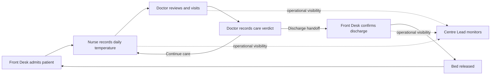

# SAJAG

## Every patient. Every day. Nothing dropped.

**Product management submission · Technical Product Manager**  
**Prepared by:** [Your name]  
**Role applied for:** [Role title]  
**Date:** [Submission date]  
**Care setting:** Sahyadri Care Centre · 74-bed quarantine facility

> **Live prototype:** [ADD VERIFIED VERCEL URL](https://your-project.vercel.app)  
> Full URL: `https://your-project.vercel.app` — replace this placeholder with the deployed URL before sharing.  
> Best viewed in Chrome. Start with **Help → Reviewer Walkthrough**. Demo data is fictional and stored in this browser only. This prototype is not for clinical use.

**QR code:** [Insert a QR code that points to the verified live URL here.] Keep the printed URL beside it so the destination remains readable if the code cannot be scanned.

### The idea

Sajag makes the daily care relay visible: **Front Desk admits → Nurse records temperature → Doctor reviews and visits → Doctor records a verdict → Front Desk processes a discharge → Centre Lead monitors the ward.** Its first release addresses missed or duplicate readings, visits made before a reading is available, unclear discharge handoffs, and limited operational visibility. The app demonstrates four staff roles plus a System actor that derives queues and status.

### Review Sajag in three minutes

1. Open **Help** and choose **Reviewer Walkthrough** for the one-time, role-aware on-screen guide.
2. In **Nurse**, open a patient awaiting a temperature and record one reading.
3. Switch to **Doctor** and see the patient move into the visit workflow; record a note and verdict.
4. Switch to **Front Desk** to process a discharge handoff, or open **Beds** to inspect occupancy and free beds.
5. Open **Centre Lead** to review the operational overview. Visit **Settings** to reset the demo or load a scenario.

> The role switcher is a prototype control, not authentication. Do not enter real patient information.

<!-- PAGE BREAK -->

# Q1 · Users, needs, and features

## Users and responsibilities

| User / actor | Primary need | Sajag responsibility in V1 | Write access in prototype |
|---|---|---|---|
| **Nurse** | Know who still needs a daily reading; avoid duplicate work | Review the due queue, record one temperature, see an existing reading and patient history | Temperature entry |
| **Doctor** | Spend visit time on care, with today’s reading ready | Review measured patients, record visit notes and treatment plan, choose a care or discharge verdict | Visit, plan, and verdict |
| **Front Desk** | Know which discharges are confirmed and which beds are available | Admit to an available bed, process doctor handoffs, release beds, and review occupancy | Admission and discharge processing |
| **Centre Lead** | See coverage, exceptions, occupancy, and outcomes | Review ward-level indicators and attention flags without changing clinical records | Read-only |
| **System** | Keep the relay consistent and visible | Derive role queues, prevent duplicate daily readings, surface ordering and eligibility rules, and calculate demo indicators | Automated state and derived views |

## Role-to-feature matrix

| Feature | Nurse | Doctor | Front Desk | Centre Lead | System |
|---|:---:|:---:|:---:|:---:|:---:|
| Daily due queue | Use | Review | — | Monitor | Derive |
| Record one official daily temperature | Own | Read | — | Read | Validate |
| Review reading and prior history | Use | Use | Lookup | Read | Store in browser |
| Doctor visit, note, treatment, verdict | — | Own | Receive handoff | Read | Validate and route |
| Standard discharge recommendation | — | Own when eligible | Receive | Monitor | Check 3-day rule |
| Early discharge with reason | — | Propose with reason | Process handoff | Monitor | Preserve reason in demo history |
| Admit and assign bed | — | — | Own | Monitor | Check capacity and duplicate name |
| Process discharge and release bed | — | — | Own | Monitor | Update occupancy |
| Occupancy, coverage, attention, outcomes | — | — | Operational view | Own read-only view | Calculate demo indicators |

## Problem-to-solution mapping

| Reported problem | V1 response | Where the reviewer sees it |
|---|---|---|
| Nurses cannot tell who has already been measured | One visible daily queue; saved readings appear on the patient; duplicate daily entry is blocked | Nurse **Round**, patient record, temperature dialog |
| Some readings are duplicated while others are missed | Role-owned due queue and one-reading rule make outstanding work explicit | Nurse **Round** and patient list |
| Doctor visits happen before the daily temperature | Measured patients become ready for the Doctor; unmeasured patients are labelled as waiting for Nurse | Doctor **Round** and patient row |
| Discharge recommendation does not reach administration | Doctor verdict creates a visible Front Desk handoff; bed is released only when processed | Doctor patient workflow, Front Desk queue, **Beds** |
| Patients may stay longer because work is not coordinated | A visible handoff and bed state make the next operational action discoverable | **Round**, **Beds**, ward snapshot |
| Centre cannot compare outcomes with the 85% success / 15% mortality benchmark | Outcome and mortality views are demonstrated with explicit cohort and definition caveats | **Centre Lead** overview and **Settings** demo scenarios |

## Scope boundary

| V1 prototype now | Later, after operational and clinical validation |
|---|---|
| Role-specific queues; temperature entry and confirmation; visit notes and verdict; discharge handoff; bed map; patient lookup; guide; activity feed; demo settings and reset | Authentication and server authorization; durable shared database; real audit trail and corrections; notifications and shift scheduling; integrations; treatment templates; exportable cohort analytics; production-grade backup, monitoring, and retention |

**Product decision:** V1 prioritizes *visibility of the next owner and handoff* over automating clinical decisions. The app supports coordination; clinicians remain responsible for care decisions.

<!-- PAGE BREAK -->

# Q2 · Prototype and walkthrough

## Live prototype and technical approach

> **Live prototype:** [ADD VERIFIED VERCEL URL](https://your-project.vercel.app) · Full URL: `https://your-project.vercel.app`  
> Replace both occurrences with the verified production URL. The URL above is a placeholder, not a claim that a deployment is live.

| Layer | Current implementation | Why it fits this assessment prototype |
|---|---|---|
| UI | React 18, TypeScript, Vite | Typed, component-based front end with a quick static production build |
| Interaction | React state, browser `localStorage`, Framer Motion | Demonstrates role flows, persistence in one browser, and restrained transitions without introducing a backend |
| Visual system | Authored CSS; Sora and DM Sans; IBM Plex Mono for readings; Lucide icons | Distinct Sajag visual identity, responsive layout, and readable numeric values without a generic component kit |
| Hosting | Vercel static deployment; output directory `dist`; `vercel.json` SPA rewrite | Fits Vite static output; no server environment variables are required for the prototype |
| Quality checks | TypeScript build, Vitest domain tests | Checks that the prototype compiles and that key rules and calculations behave as expected |

### Key screens to capture before export

The images are intentionally left as capture slots: no verified screenshot files were supplied with this document. Capture the deployed build after replacing the demo state and link as needed. Prefer a 1280 px desktop screenshot and a 360–390 px mobile screenshot. Use fictional data only.

| Screen | Insert image | Caption |
|---|---|---|
| Nurse · Today’s round | `[Insert desktop/mobile screenshot]` | A due queue makes the Nurse’s next reading easy to find and records progress once per patient per day. |
| Doctor · Ready for your visit | `[Insert desktop/mobile screenshot]` | The Doctor sees measured patients ready for review and an explicit waiting state when the Nurse’s reading is missing. |
| Front Desk · Discharge handoffs | `[Insert desktop/mobile screenshot]` | Confirmed handoffs are actionable; processing one releases the bed and updates occupancy. |
| Centre Lead · Centre pulse | `[Insert desktop/mobile screenshot]` | A read-only overview shows the state of the daily relay and operational attention flags. |
| Beds · Ward floor plan | `[Insert screenshot if space permits]` | The 74-bed map distinguishes occupied, fever-flagged, discharge-ready, and available beds. |

## Care relay

## Key workflows

### Record a temperature (Nurse)

1. Choose **Nurse** from the role picker and open **Today’s round**.
2. Select a patient still waiting for a reading and choose **Record temp**.
3. Enter the measured value in Celsius. The prototype accepts 34.0–42.0°C; values below 35.0°C or above 40.5°C prompt confirmation.
4. Save. A second official reading for the same patient/day is blocked; the patient’s state moves into the Doctor’s measured queue.
5. The patient record and activity feed show the reading. Demo changes persist in this browser’s local storage.

### Review and visit a patient (Doctor)

1. Switch to **Doctor**. Patients with a reading are ready for review; patients without one remain marked **Waiting for nurse**.
2. Open a ready patient, review the available temperature/history, and enter a visit note and treatment plan.
3. Record a continuing-care verdict or a discharge recommendation. The standard recommendation is surfaced only after the prototype’s three-day eligibility check. Early discharge and deceased outcomes require a reason in the UI.
4. A discharge verdict creates a Front Desk handoff. A visit itself does not release a bed.

### Process a discharge (Front Desk)

1. Switch to **Front Desk** and open **Discharge handoffs**.
2. Review the patient and confirm the discharge action.
3. Sajag records the demo outcome, marks the bed free, and updates occupancy. Front Desk can then admit an eligible new patient to that bed.

### Admit a patient (Front Desk)

1. Open **Beds** and select an available tile.
2. Enter a name and age; the prototype checks required name, age range, duplicate active name, and bed availability.
3. Confirm to assign the selected bed. The new patient appears in the active round.

## Prototype limits and verification status

- **No backend or authentication:** local browser state is not a shared source of truth, and role switching is not access control. Different devices do not share updates.
- **Fictional data:** do not enter personally identifiable or real patient information. Browser storage does not provide production security, backup, or an audit trail.
- **Simulated clock and seeded histories:** demo scenarios and outcome records exist to make the workflow reviewable; they are not facility data or validated quality reporting.
- **Clinical definitions are provisional:** 38.0°C, suspect ranges, and the interpretation of “three full days” need head-doctor approval before any operational use.
- **Automated checks:** current project checks include a production build, TypeScript validation, and 64 domain tests. These do not establish clinical safety or production readiness.
- **Deployment:** the Vercel URL must be verified after deployment. Test it in a private window, test direct routes, and inspect desktop and mobile layouts before submitting.

<!-- PAGE BREAK -->

# Q3 · Business rules and safeguards

Sajag uses three response levels to communicate what the user can do next. The software should make the reason visible and preserve a clear route for legitimate exceptions.

| Level | Meaning | Example |
|---|---|---|
| **Block** | Stop an action that violates an operational rule; explain what is missing or who owns it | Block a duplicate daily reading or a routine Doctor visit before today’s reading |
| **Confirm** | Allow a deliberate action after the user checks the risk or provides a reason | Confirm a suspect temperature, an early discharge, or a Front Desk bed release |
| **Nudge** | Surface useful status or eligibility without substituting for clinical judgment | Show a three-day fever-free eligibility signal or missing reading |

## Rule catalogue

| Area | Rule and prototype behaviour | Level / owner | Production consideration |
|---|---|---|---|
| Temperature · ownership | Only Nurse may record the official daily reading | Block · Nurse | Enforce on the server using authenticated staff identity and role authorization |
| Temperature · duplicate | One official reading per patient per care day; keep the existing value visible and do not silently overwrite | Block · Nurse | Define repeat measurement, correction window, reason, attribution, and audit history |
| Temperature · plausible range | Reject a non-number or value outside 34.0–42.0°C | Block · Nurse | Validate units, device protocol, data entry, and approved clinical ranges |
| Temperature · suspect range | A value below 35.0°C or above 40.5°C prompts a reconfirmation | Confirm · Nurse | These thresholds are illustrative and must be set by clinical leadership |
| Fever status | Prototype marks 38.0°C or higher as fever | Nudge / calculation · System | Confirm the measurement method, threshold, and whether the rule is age/context dependent |
| Visit ordering | Routine Doctor visit requires today’s temperature; otherwise show **Waiting for nurse** | Block · Doctor | The doctor must retain an approved urgent override that records a reason and is visible in the audit log |
| Three-day eligibility | Surface standard discharge eligibility after three consecutive fever-free days; a fever or missing day breaks the streak | Nudge · System/Doctor | “Three full days” could mean 72 hours or three defined calendar days. Confirm policy and timezone. Do not auto-discharge. |
| Standard discharge | Doctor records a recommendation; Front Desk processes the handoff and releases the bed | Nudge → Confirm · Doctor/Front Desk | Define authorized clinical sign-off and required discharge documentation |
| Early discharge | Require a reason and distinguish it from the standard three-day criterion | Confirm · Doctor | Approval authority and clinical criteria need explicit policy |
| Admission | Only Front Desk admits; block if no bed is free or an active patient with the same name exists | Block · Front Desk | Use a safe patient identifier; name alone is not a reliable identity match |
| Outcome reporting | Demo mortality is deaths / closed demo cases × 100 and is compared with the 15% reference | Nudge · Centre Lead/System | Define cohort, time window, transfers, minimum sample, exclusions, confidence, and review cadence |
| Daily coverage | Show whether active patients have a temperature and a Doctor visit recorded today | Nudge · Centre Lead | Specify the care-day boundary, due time, overdue escalation, and exception handling |
| System time | Demo clock can advance to show daily queue rollover | Nudge · System | Production timestamps must be server-generated, timezone-aware, and traceable |
| Privacy and access | Prototype data stays in browser storage; role picker is a demo affordance | Important limitation | Production requires authentication, server authorization, encryption, retention policy, audit, backup, and incident response |

> **Assumptions to confirm with the head doctor before real use**
>
> 1. What fever threshold and measurement protocol should Sajag use, and should either vary by patient group?
> 2. Does “three full days without a fever” mean three consecutive calendar-day readings, 72 elapsed hours, or another approved interpretation?
> 3. Does a missing daily reading break the streak? How should repeat or corrected readings be handled and attributed?
> 4. What constitutes an urgent visit override, who may authorize it, and what reason must be recorded?
> 5. Who signs off a standard or early discharge, and what information must be communicated to the patient and Front Desk?
> 6. How should deaths, transfers, readmissions, and incomplete cases affect the mortality/success rate? What cohort period and minimum denominator are appropriate?
> 7. What daily deadline, escalation route, and local timezone govern missed temperatures and visits?

### Quality metric interpretation

The brief states an expected mortality rate of 15% and an 85% success benchmark. These percentages are complements only if the case definition and denominator are aligned. A small or incomplete cohort can move sharply with one outcome. Sajag’s prototype indicator must therefore be treated as an illustration, not a validated performance measure or clinical alert. Centre leadership should approve the cohort, period, minimum sample, and handling of transfers before using it for decisions.

<!-- PAGE BREAK -->

# Q4 · Sprint planning

## Capacity and selection

Sprint capacity is **25 points**. Existing commitments consume **15**, leaving **10 points** for the candidate work. The assessment brief specifies the final selection below; the item-level A–J descriptions, value scores, and effort scores were not included in the project materials available for this document. I have preserved the stated selection and totals and have not invented per-item ratios.

| Capacity calculation | Points |
|---|---:|
| Total sprint capacity | 25.0 |
| Existing commitments | −15.0 |
| **Remaining for candidate stories** | **10.0** |
| Selected stories’ stated effort | +8.3 |
| **Total planned load** | **23.3 / 25.0** |
| **Unallocated buffer** | **1.7** |

## Candidate scorecard and final pick

The assessment supplies a Low / Medium / High value scale of **1 / 3 / 6** and the aggregate selected value of **22**. Complete each story’s description, value, and effort from the original A–J assessment before PDF submission. The ratio formula is `value ÷ effort`; ratios are intentionally left blank where source inputs are unavailable.

| Story | Value (1 / 3 / 6) | Effort | Value ÷ effort | Sprint decision |
|---|---:|---:|---:|---|
| A | [from source brief] | [from source brief] | [calculate] | **Pick** |
| B | [from source brief] | [from source brief] | [calculate] | **Pick** |
| C | [from source brief] | [from source brief] | [calculate] | Leave out |
| D | [from source brief] | [from source brief] | [calculate] | **Pick** |
| E | [from source brief] | [from source brief] | [calculate] | Leave out |
| F | [from source brief] | [from source brief] | [calculate] | **Pick** |
| G | [from source brief] | [from source brief] | [calculate] | **Pick** |
| H | [from source brief] | [from source brief] | [calculate] | **Pick** |
| I | [from source brief] | [from source brief] | [calculate] | **Pick** |
| J | [from source brief] | [from source brief] | [calculate] | **Pick** |
| **Selected total (assessment-provided)** | **22** | **8.3** | **22 ÷ 8.3 = 2.65 aggregate** | **A, B, D, F, G, H, I, J** |

**Decision:** select **A, B, D, F, G, H, I, J**; leave out **C and E**. This uses 8.3 of the 10 points remaining after existing commitments, for 23.3 of 25 points overall and a 1.7-point buffer.

**Why C is excluded:** the A–J story descriptions and individual scores are not present in the available source material, so a defensible story-specific reason cannot be stated without inventing it. Add the reason from the original prioritization brief before sending this submission.

**Dependency and risk caveat:** the selected set is an assessment-provided target, not an independently optimized plan. Confirm story dependencies, owner availability, and the unprovided item-level estimates before commitment. Protect the 1.7-point buffer for integration, validation, and unplanned work; if a dependency blocks a selected item, re-plan against the visible value/effort inputs rather than silently exceeding capacity.

<!-- PAGE BREAK -->

# Delivery notes · Measures, decisions, and risks

## Success measures to validate in a pilot

| Measure | Definition | Why it matters |
|---|---|---|
| Daily temperature coverage | Active patients with an official reading today ÷ active patients due today | Measures whether the Nurse round is complete |
| Doctor visit coverage | Active patients visited today ÷ active patients requiring a visit today | Measures completion of the same-day Doctor requirement |
| Ordering compliance | Routine visits after a same-day reading ÷ routine visits | Tests whether the Nurse-to-Doctor dependency is working |
| Duplicate-reading rate | Duplicate attempts or saved duplicates per 100 patient-days | Tests reduced rework; distinguish blocked attempts from data errors |
| Discharge handoff delay | Time from Doctor recommendation to Front Desk processing | Finds avoidable bed-days caused by communication gaps |
| Occupancy and bed turnaround | Occupied beds ÷ 74; time from discharge processing to next admission | Measures throughput while keeping bed status visible |
| Outcome rate | Approved outcome numerator ÷ approved closed-case denominator, by defined cohort and period | Tracks the 15% mortality / 85% success benchmark only after clinical and statistical definitions are approved |

No baseline or target has been invented. Establish a baseline from reliable facility data and set targets with the care team before evaluating impact.

## Decision log

| Decision | Rationale | Revisit when |
|---|---|---|
| Queues are organized by role and next action | Reduces ambiguity about who owns today’s next step | Pilot feedback shows queue ordering or ownership is unclear |
| A Doctor recommendation is a handoff, not an automatic bed release | Keeps clinical decision and administrative processing distinct | Facility discharge policy and authorization are documented |
| Centre Lead is read-only in the prototype | Oversight should not accidentally alter care or handoffs | Production permissions and delegated workflows are approved |
| Use a local demo state and fictional seed data | Enables a fast, reviewable Vercel prototype without backend setup | Before any live facility pilot; production requires secure shared records |
| Treat threshold, streak, and mortality rules as provisional | Clinical and reporting definitions were not supplied | Head doctor and centre leadership approve a written policy |

## Key risks and mitigations

| Risk | Potential impact | Mitigation / release condition |
|---|---|---|
| Provisional clinical thresholds or streak semantics | Incorrect eligibility or workflow cues | Obtain written clinical approval; version and audit policy changes |
| Local-only data and simulated roles | Staff may see inconsistent data or access records improperly | Do not use for patient care; implement backend identity, authorization, shared storage, audit, and backups |
| Misleading mortality percentage | Poor decisions from small or inconsistent cohorts | Agree denominator, cohort dates, minimum sample, transfer handling, and uncertainty display |
| Missed or delayed actions despite queue visibility | Care requirement still goes unmet | Pilot overdue definitions, escalation, ownership, and shift handoff |
| Name-based duplicate check | Different people can share a name; same person can be entered differently | Introduce a facility-approved unique identifier and identity matching workflow |
| Deployment placeholder or unverified URL | Recruiter cannot open the prototype | Deploy, test the actual Vercel URL in a private window, then replace all three URL placeholders and regenerate the QR code |

## Roadmap

| Release | Focus | Candidate capabilities |
|---|---|---|
| **V1 · Visibility** | Make daily work and handoffs explicit | Role queues, temperature capture, visit readiness, discharge handoff, bed status, basic oversight |
| **V2 · Communication** | Help teams act on work across shifts and devices | Approved reminders, shift scheduling, multi-ward support, treatment templates, audit exports, cohort analytics |
| **Production hardening** | Protect records and enforce approved policy | Authentication, server-side permissions and rules, shared database, audit, backup, monitoring, retention, accessibility and security review |

## AI tool disclosure

OpenAI Codex was used as an AI coding assistant to review the prototype, refine interface behavior, and help draft this submission. Product framing, assumptions, and final content should be reviewed and approved by the applicant and the care stakeholders. AI assistance does not validate clinical policy or replace professional judgment.

<!-- PAGE BREAK -->

# Quick links

| Resource | Link / action |
|---|---|
| **Live Sajag prototype** | [ADD VERIFIED VERCEL URL](https://your-project.vercel.app) · `https://your-project.vercel.app` *(replace placeholder and verify before sharing)* |
| **GitHub repository** | [ADD PUBLIC OR REVIEWER-ACCESSIBLE REPOSITORY URL](https://github.com/your-account/your-repository) *(replace placeholder)* |
| **In-app reviewer guide** | Open the prototype → **Help** → **Reviewer Walkthrough** |
| **Project documentation** | [README](README.md) · [Prototype guide](docs/PROTOTYPE_GUIDE.md) · [Business rules](docs/BUSINESS_RULES.md) · [Users and features](docs/USERS_AND_FEATURES.md) · [Deployment](docs/DEPLOYMENT.md) |
| **QR code** | Insert the QR image generated from the verified live URL after deployment |

### Final submission checklist

- [ ] Replace **Your name**, role title, date, and all three Vercel URL placeholders.
- [ ] Deploy Sajag and verify the live link from a private/incognito browser window.
- [ ] Add desktop and mobile screenshots for the key role screens; keep demo records fictional.
- [ ] Generate the QR code from the verified URL and insert it on page 1 and/or the quick-links page.
- [ ] Add the repository URL and confirm the reviewer can access it.
- [ ] Restore the original A–J story descriptions and individual value/effort inputs; calculate each ratio and add the source-backed reason for excluding C.
- [ ] Export to PDF, confirm hyperlinks and page breaks, and name the final PDF **`Your Name TPM.pdf`** after replacing the placeholder name.

**End of submission draft**
